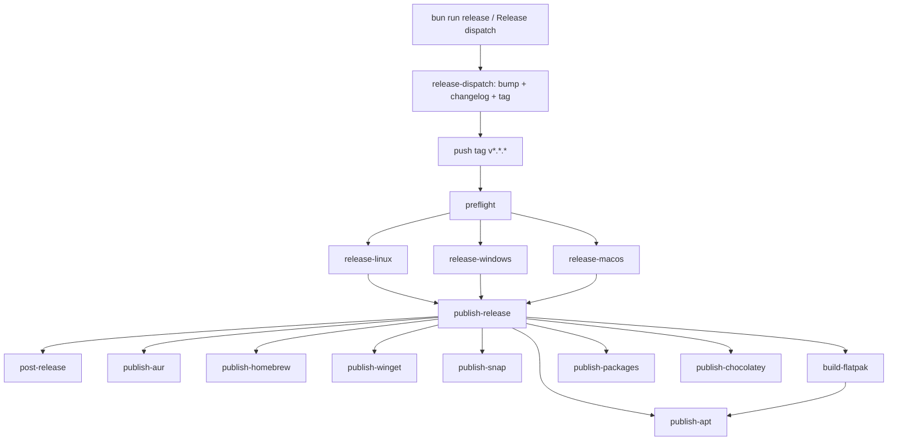

# Release Workflow

Dora ships through a tag-triggered GitHub Actions pipeline. You create and push a semver tag; CI builds every platform, publishes the GitHub release, updates repo docs, and fans out to package managers.

**Workflow file:** [`.github/workflows/release.yml`](../../.github/workflows/release.yml)
**Release notes config:** [`.github/release.yml`](../../.github/release.yml)
**Curated release notes:** [`.github/release-notes/`](../../.github/release-notes)

---

## Quick start

From your machine (requires `gh` CLI):

```bash
bun run release          # patch bump (default)
bun run release minor    # minor bump
bun run release major    # major bump
```

That dispatches the **Release dispatch** workflow, which:

1. Bumps version files on `master`
2. Prepends a `git-cliff` section to `CHANGELOG.md` (via `cliff.toml`)
3. Syncs in-app changelog TypeScript data
4. Commits, tags, and pushes
5. Triggers the **Release** workflow to build and publish assets

You can also start it from GitHub: **Actions → Release dispatch → Run workflow**.

For a local dry-run without pushing:

```bash
bash scripts/release-prepare.sh patch
```

For an interactive preflight (branch, dirty tree, version sync, GitHub auth):

```bash
bun run release:guide
# or: bash tools/scripts/release-guide.sh
```

---

## Pipeline overview



| Phase | Job | Runs on | Purpose |
| --- | --- | --- | --- |
| 0 | `release-dispatch` | `ubuntu-latest` | Bump versions, `CHANGELOG.md`, tag, push |
| 1 | `preflight` | `ubuntu-latest` | Validate metadata before any build |
| 2 | `release-linux` | `ubuntu-latest`, `ubuntu-24.04-arm` | Linux installers + tarball, x86_64 and aarch64 |
| 2 | `release-windows` | `windows-2022`, `windows-11-arm` | Windows NSIS `.exe` + updater signature, x64 and arm64 |
| 2 | `release-macos` | `macos-latest` | Universal macOS `.dmg` + updater archive |
| 3 | `publish-release` | `ubuntu-latest` | Upload assets, create GitHub release |
| 4 | `post-release` | `ubuntu-latest` | Update `README.md` on `master` |
| 5 | package managers | varies | AUR, Homebrew, Linux repositories (APT, DNF, Flatpak), Winget, Snap, Flatpak bundles, Scoop + Nix, Chocolatey as reusable-workflow jobs |

Platform builds in phase 2 run **in parallel** after preflight passes. The aarch64 Linux and arm64 Windows matrix legs are `continue-on-error`: when one fails the release still ships, and every channel lists only the architectures that reached the release. Package-manager jobs in phase 5 also run **in parallel** after the GitHub release is published.

The phase-5 jobs call `aur.yml`, `brew.yml`, `apt.yml`, `winget.yml`, `snap.yml`, `flatpak.yml`, `packages.yml` and `chocolatey.yml` via `workflow_call`, so each channel's real outcome is part of the `Release` run itself: **if any channel fails, the run goes red on that job. A green run does not prove publication**: AUR, Homebrew, Winget, Snap, Scoop and Nix, and Chocolatey skip their push when their secret is missing and still go green, so check the downstream artifact for those. There is no need to separately check each channel workflow's history under Actions; that was only necessary when these were fire-and-forget `gh workflow run` dispatches. The channel workflows all keep their `workflow_dispatch` triggers for manual re-runs of a single channel (e.g. re-publishing Homebrew after fixing a tap secret).

---

## Phase 0: Dispatch the release

1. Ensure `master` contains everything you want to ship.
2. Working tree is clean locally (CI enforces this too).
3. Run `bun run release` (or dispatch **Release dispatch** in GitHub Actions).

The dispatch job bumps `package.json`, desktop/Tauri/Cargo versions, prepends a `git-cliff` entry to `CHANGELOG.md`, syncs in-app changelog data, commits `chore(release): vX.Y.Z`, creates the tag, and pushes `master` + the tag.

Tags must match `vMAJOR.MINOR.PATCH` (plain semver, no suffix). Pushing the tag starts the `Release` workflow.

Do **not** create or publish the GitHub release by hand. Manual publication before CI finishes is the main failure mode for APT, AUR, Homebrew, and Winget (they expect release assets to exist).

**Emergency re-tag only:** `tag-create.yml` tags an existing SHA without version bumps. Use it only when recovering a broken release, not for normal shipping.

---

## Phase 1: `preflight`

Fails fast before any expensive build starts.

### Version checks

| Source | Path |
| --- | --- |
| Git tag | `v0.27.0` → `0.27.0` |
| Desktop package | `apps/desktop/package.json` |
| Tauri config | `apps/desktop/src-tauri/tauri.conf.json` |
| Cargo manifest | `apps/desktop/src-tauri/Cargo.toml` |

The tag version must equal the desktop, Tauri, and Cargo versions. A mismatch aborts the workflow.

Root `package.json` is checked separately; if it differs, CI logs a warning but continues (desktop/Tauri/Cargo are authoritative for release assets).

### Bundle and packaging checks

Preflight also verifies:

- Required Tauri bundle targets: `app`, `deb`, `rpm`, `appimage`, `nsis`, `dmg`
- `bundle.createUpdaterArtifacts` is enabled
- Distribution files exist (AUR PKGBUILD, desktop entry, Snap/Flatpak manifests, generator scripts)

---

## Phase 2: Platform builds

Three jobs run in parallel. Each job:

1. Checks out the repo
2. Installs Bun, Rust, and platform-specific dependencies
3. Runs `bun install` and `bun run build` in `apps/desktop`
4. Runs `tauri build` via `tauri-apps/tauri-action`
5. Uploads build artifacts

### Linux (`release-linux`)

**Runner:** `ubuntu-latest`

**Outputs:**

| Asset | Description |
| --- | --- |
| `.deb` | Debian package |
| `.rpm` | RPM package |
| `.AppImage` | Portable Linux build |
| `dora-<arch>-unknown-linux-gnu.tar.gz` | Lightweight tarball for AUR (binary extracted from the `.deb`) |
| `checksums-linux.txt`, `checksums-linux-aarch64.txt` | Checksums for AppImage, deb, rpm |

The x86_64 build names its files `_amd64` / `.x86_64`, the aarch64 build `_arm64` / `_aarch64` / `.aarch64`.

### Windows (`release-windows`)

**Runner:** `windows-latest`

**Outputs:**

| Asset | Description |
| --- | --- |
| `.exe` | NSIS installer |
| `.exe.sig` | Signed updater artifact |
| `checksums-windows.txt`, `checksums-windows-arm64.txt` | Checksums for the NSIS installer |

The installers are `Dora_<version>_x64-setup.exe` and `Dora_<version>_arm64-setup.exe`.

### macOS (`release-macos`)

**Runner:** `macos-latest`

**Outputs:** `Dora_<version>_universal.dmg` and `Dora.app.tar.gz`, built with `--target universal-apple-darwin`. `apps/desktop/scripts/build-duckdb-helper.ts` builds the DuckDB sidecar for both architectures and merges them with `lipo`.

---

## Phase 3: `publish-release`

Waits for all three platform jobs, then:

1. **Downloads** every artifact from the workflow run
2. **Validates** the asset set:
   - At least **11** files total
   - The x86_64 set: `_x64-setup.exe` (+ `.sig`), `_amd64.AppImage` (+ `.sig`), `_amd64.deb`, `.x86_64.rpm`, the x86_64 tarball, `checksums-linux.txt`, `checksums-windows.txt`
   - The macOS set: `_universal.dmg`, `.app.tar.gz` (+ `.sig`)
   - arm64 files are uploaded when present and never required
3. **Creates the GitHub release** with `git-cliff` notes from `cliff.toml` (or curated `.github/release-notes/<tag>.md` when present):

```bash
git-cliff v0.27.0..v0.28.0 > /tmp/release-notes.md
gh release create v0.28.0 \
  --title "Dora v0.28.0" \
  --notes-file /tmp/release-notes.md \
  <all assets...>
```

If `.github/release-notes/<tag>.md` exists, that file is used instead of git-cliff output.

The job also builds the **updater manifest** (`latest.json`) from the signed
`.sig` artifacts via [`tools/scripts/generate-latest-json.ts`](../../tools/scripts/generate-latest-json.ts)
and attaches it to the release. See [Auto-updates](#auto-updates-tauri-updater).

If an empty pre-created release exists for the tag, CI deletes it and recreates. If a release already has assets, the job fails rather than overwrite.

---

## Phase 4: `post-release`

Runs on `master` after the release is published.

1. **Updates** `README.md`:
   - Replaces `<version>` placeholder
   - Updates any previously hardcoded semver strings

`CHANGELOG.md` and in-app changelog data are already committed by **Release dispatch** before the tag is pushed.

2. **Commits and pushes** to `master` when README changed:

```
chore(release): update README for v0.27.0
```

---

## Phase 5: Package manager channels

These jobs run in parallel after `publish-release` succeeds. Each calls a dedicated channel workflow as a reusable workflow (`workflow_call`) with the release tag, so the channel's success or failure is the job's own status inside the `Release` run:

| Job | Workflow | Notes |
| --- | --- | --- |
| `publish-aur` | `aur.yml` | Arch User Repository |
| `publish-homebrew` | `brew.yml` | `publish=true` |
| `publish-apt` | `apt.yml` | `publish=true` |
| `publish-winget` | `winget.yml` | `submit_update=true` |
| `publish-snap` | `snap.yml` | `publish=true`, `release_channel=stable` |
| `build-flatpak` | `flatpak.yml` | Uploads `Dora-<version>-<arch>.flatpak` to the GitHub release |
| `publish-apt` | `apt.yml` | Runs after `build-flatpak`; deploys the APT, DNF and Flatpak repositories to Pages |
| `publish-packages` | `packages.yml` | Scoop bucket + Nix flake in `remcostoeten/dora-packages`, `publish=true` |
| `publish-chocolatey` | `chocolatey.yml` | `publish=true`, pushes only when `CHOCOLATEY_API_KEY` is set |

No manual repackaging is required per release. See [All distribution channels](#all-distribution-channels) below and [Appendix: package manager recovery](#appendix-package-manager-recovery-historic) if a store listing breaks.

---

## Auto-updates (Tauri updater)

Installed apps check for updates via the [`tauri-plugin-updater`](https://v2.tauri.app/plugin/updater/).
The in-app **Settings → Updates** section checks on open and lets the user install
and restart. The desktop app polls a single endpoint:

```
https://github.com/remcostoeten/dora/releases/latest/download/latest.json
```

`latest.json` is generated during `publish-release` from the signed updater
artifacts and points each platform at its download URL + signature:

| Platform key | Artifact | Built by |
| --- | --- | --- |
| `linux-x86_64` | `.AppImage` + `.AppImage.sig` | `release-linux` |
| `windows-x86_64` | NSIS `-setup.exe` + `.exe.sig` | `release-windows` |
| `darwin-aarch64`, `darwin-x86_64` | universal `.app.tar.gz` + `.app.tar.gz.sig` | `release-macos` |
| `linux-aarch64` | `_aarch64.AppImage` + `.sig` (optional) | `release-linux` aarch64 |
| `windows-aarch64` | `_arm64-setup.exe` + `.sig` (optional) | `release-windows` arm64 |

Config lives in [`tauri.conf.json`](../../apps/desktop/src-tauri/tauri.conf.json)
under `plugins.updater` (endpoint + public key) and `bundle.createUpdaterArtifacts: true`.

### One-time bootstrap (required before the first signed release)

The updater only works once the signing key exists as a CI secret. The key pair
was generated with `bun tauri signer generate` (minisign); the **public** key is
committed in `tauri.conf.json`, the **private** key must be added as a secret:

1. Generate (if rotating): `cd apps/desktop && bun x tauri signer generate -w ~/.tauri/dora-updater.key`
2. Add GitHub repository secrets:
   - `TAURI_SIGNING_PRIVATE_KEY`: full contents of `~/.tauri/dora-updater.key`
   - `TAURI_SIGNING_PRIVATE_KEY_PASSWORD`: the key password (empty string if none)
3. If you regenerated the key, replace `plugins.updater.pubkey` in `tauri.conf.json`
   with the new `*.key.pub` contents and commit.

Without these secrets the platform builds still succeed but produce **no `.sig`
files**, and `generate-latest-json.ts` fails the publish job (by design, since a
release with no updater manifest would silently break auto-update).

> **Key custody:** losing the private key means no installed app can verify a
> future update. You'd have to ship a new pubkey and every existing user would
> be stranded on their current version. Back it up in a password manager.

### macOS code signing and notarization

The macOS job signs and notarizes the `.app` when these repository secrets are
set. Without them it prints a workflow warning and ships an unsigned bundle,
which Gatekeeper blocks on first launch.

1. Enroll in the Apple Developer Program and create a **Developer ID
   Application** certificate in Xcode or at developer.apple.com.
2. Export the certificate as a `.p12` with a password, then base64-encode it:
   `base64 -i DeveloperID.p12 | pbcopy`.
3. Create an app-specific password for your Apple ID at appleid.apple.com.
4. Add GitHub repository secrets:
   - `APPLE_CERTIFICATE`: the base64 `.p12`
   - `APPLE_CERTIFICATE_PASSWORD`: the `.p12` export password
   - `APPLE_SIGNING_IDENTITY`: the certificate name, e.g.
     `Developer ID Application: Remco Stoeten (TEAMID)`
   - `APPLE_ID`: the Apple ID email
   - `APPLE_PASSWORD`: the app-specific password
   - `APPLE_TEAM_ID`: the 10-character team ID

When `APPLE_CERTIFICATE` is set, all six are required and the job fails fast if
one is missing. After the build, `codesign --verify`, `spctl --assess` and
`xcrun stapler validate` run against the `.app`, so a release cannot publish a
bundle that claims to be signed but is not.

---

## All distribution channels

Not everything is a separate “package manager workflow.” A tagged release produces **GitHub release assets** first; the **store/registry workflows** fan out from there.

### GitHub Releases (automatic, no extra workflow)

Built by `release.yml` and attached to every release. Users install directly from the release page:

| Asset | Platform | Store workflow |
| --- | --- | --- |
| `_universal.dmg` | macOS (Apple Silicon and Intel) | Also feeds Homebrew |
| `_x64-setup.exe`, `_arm64-setup.exe` | Windows | Also feed Winget, Scoop, Chocolatey (x64) |
| `.deb` (amd64, arm64) | Debian/Ubuntu | Also feeds the APT repo and the Nix flake |
| `.rpm` (x86_64, aarch64) | Fedora/RHEL/openSUSE | Also feeds the DNF repo |
| `.AppImage` | Linux portable | Direct download, Linux updater target |
| `Dora-<version>-<arch>.flatpak` | Any Linux | Built from the `.deb` by `flatpak.yml`, feeds the Flatpak remote |
| `dora-<arch>-unknown-linux-gnu.tar.gz` | Arch tarball | Also feeds AUR |
| `checksums-*.txt` | All | Used by Winget manifest generation |

### Store / registry (automatic, run as part of the Release workflow after publish)

| Channel | Workflow | Install example |
| --- | --- | --- |
| AUR | `aur.yml` | `yay -S dora` |
| Homebrew | `brew.yml` | `brew install --cask remcostoeten/dora/dora` |
| APT | `apt.yml` | `apt install dora` (Pages: `/`) |
| DNF | `apt.yml` | `dnf install dora` (Pages: `/rpm/dora.repo`) |
| Flatpak remote | `apt.yml` + `flatpak.yml` | `flatpak install --user https://remcostoeten.github.io/dora/flatpak/io.github.remcostoeten.dora.flatpakref` |
| Winget | `winget.yml` | `winget install RemcoStoeten.Dora` |
| Snap | `snap.yml` | `snap install dora` |
| Scoop | `packages.yml` | `scoop bucket add dora https://github.com/remcostoeten/dora-packages` |
| Nix | `packages.yml` | `nix profile install github:remcostoeten/dora-packages` |
| Chocolatey | `chocolatey.yml` | `choco install dora` (after the first moderated push) |

### External or not automated in this repo

| Channel | Status |
| --- | --- |
| **Flathub** | Manifest ready in `packaging/flathub/`; needs a one-time submission PR to `flathub/flathub`, see its README |
| **Microsoft Store** | Not implemented; needs a Partner Center account |
| **homebrew/cask, nixpkgs** | Not submitted; the own tap and flake cover these users |
| **macOS notarization, Windows Authenticode** | Not configured; builds are unsigned |

The appendix below covers recovery for the automated store workflows only. GitHub release assets are rebuilt automatically whenever `release.yml` succeeds; you only need to re-bootstrap a store if its listing or secrets are lost.

---

## Release notes and commit messages

Release notes are generated by **git-cliff** using [`cliff.toml`](../../cliff.toml). Commits are grouped by message prefix:

| Prefix | Section |
| --- | --- |
| `feat` | Features |
| `fix` | Bug Fixes |
| `docs` | Documentation |
| `perf` | Performance |
| `refactor` | Refactoring |
| `test` | Testing |
| `chore` | Chores |
| `ci` | CI/CD |
| `style` | Styling |
| `build` | Build |
| *(other)* | Other |

`chore(release)`, WIP, and merge commits are skipped.

For releases that need a fuller human summary, add `.github/release-notes/<tag>.md` before dispatching. The publish job uses that file instead of git-cliff output.

---

## Pre-release checklist

Before dispatching:

- [ ] All intended changes are merged to `master`
- [ ] Working tree is clean (`git status`)
- [ ] Commit messages since the last tag use recognizable prefixes (`feat`, `fix`, `docs`, …)
- [ ] GitHub CLI auth works if running `bun run release` locally

Optional: run `bun run release:guide` for an automated sanity check.

---

## What a successful release produces

**GitHub release page**

- Linux: deb, rpm, AppImage, tarball, checksums
- Windows: msi, exe, checksums
- macOS: ARM `.dmg`

**Repo updates**

- New `CHANGELOG.md` entry (from Release dispatch, before the tag)
- Updated `README.md` version strings (from `post-release`)
- Regenerated TypeScript changelog data (from Release dispatch)

**Downstream**

- Package manager workflows triggered with the new tag

---

## Troubleshooting

### Preflight fails on version mismatch

Update `apps/desktop/package.json`, `tauri.conf.json`, and `Cargo.toml` to the same semver, commit, then tag again.

### `publish-release` fails: fewer than 11 assets

One or more platform jobs failed or produced incomplete artifacts. Open the failed platform job log first.

### Missing `.exe` or `.exe.sig`

The Windows job failed or did not upload the NSIS bundle and updater signature. Check `release-windows` logs, signing secrets, and the `nsis` target in `tauri.conf.json`.

### Package manager workflow fails immediately

Usually means the GitHub release or its assets are not ready yet. Confirm `publish-release` finished and the release page lists all installers before debugging AUR/Homebrew/APT/Winget.

### Release notes are mostly "Other"

Commits since the last tag don't use recognized prefixes (`feat`, `fix`, `docs`, …). Use those prefixes in commit messages going forward.

### `post-release` did not commit

README version strings already matched, so nothing changed. Check the `post-release` job log and branch protection rules if a push failed.

---

## Related

- Interactive preflight: `bun run release:guide`
- AI-assisted release notes draft: `docs/distribution/ai-release-notes.md`
- Agent guidelines for labels and changelog tone: `AGENTS.md`

---

## Appendix: Package manager recovery (historic)

> **Historic reference only.** Package manager publishing is already configured and runs automatically on every tagged release. You do not need this section for normal releases, and nobody should clone the repo to repackage or publish manually.
>
> **Read this only if** a channel was removed from a store/registry, GitHub secrets expired, or CI can no longer publish to that channel and you need to bootstrap it again.

### AUR

**Workflow:** `.github/workflows/aur.yml`  
**Package:** `dora` on AUR, built from `dora-x86_64-unknown-linux-gnu.tar.gz` on the GitHub release.

1. Create the `dora` package at [aur.archlinux.org](https://aur.archlinux.org).
2. Generate a deploy key: `ssh-keygen -t ed25519 -C "github-actions-aur" -f ./aur_deploy_key`
3. Add the public key to your AUR account.
4. Set GitHub secrets:
   - `AUR_SSH_PRIVATE_KEY`
   - `AUR_KNOWN_HOSTS` (pinned `aur.archlinux.org` entry)
5. Helper script: `bash packaging/aur/setup-aur-publishing.sh`
6. Tag a release. `aur.yml` updates `packaging/aur/PKGBUILD`, commits to this repo, and pushes to AUR.

Local validation: `cd packaging/aur && makepkg -si`, or `bash tools/scripts/test-aur-docker.sh`.

### Homebrew

**Workflow:** `.github/workflows/brew.yml`  
**Tap:** `remcostoeten/homebrew-dora`

1. Create the tap repo if it does not exist.
2. Set GitHub secret `HOMEBREW_SSH_PRIVATE_KEY` (deploy key with push access to the tap).
3. Tag a release. `brew.yml` generates the Cask from release DMGs and pushes to the tap when `publish=true`.

### Linux repositories (APT, DNF, Flatpak remote)

**Workflow:** `.github/workflows/apt.yml`  
**Site:** `https://remcostoeten.github.io/dora`

1. Enable GitHub Pages on the repository with the GitHub Actions source.
2. Set GitHub secret `GPG_PRIVATE_KEY`. One key signs the APT `Release`, the DNF `repomd.xml` and the Flatpak commits; its public half is served as `KEY.gpg`.
3. Tag a release. `apt.yml` waits for the `.deb`, `.rpm` and `.flatpak` assets, rebuilds all three repositories and deploys the site when `publish=true`. A Pages deploy replaces the whole site, so the three are always rebuilt together.

### Winget

**Workflow:** `.github/workflows/winget.yml`  
**Package ID:** `RemcoStoeten.Dora`

First-time bootstrap (Windows, one-time):

```powershell
winget install wingetcreate
wingetcreate new "https://github.com/remcostoeten/dora/releases/download/vX.Y.Z/Dora_X.Y.Z_x64-setup.exe"
```

After the `microsoft/winget-pkgs` PR merges:

1. Set GitHub secret `WINGET_CREATE_GITHUB_TOKEN` (classic PAT, `public_repo` scope).
2. Set repository variable `WINGET_PACKAGE_READY=true`.
3. Tag a release. `winget.yml` generates manifests and submits update PRs automatically.

### Snap

**Workflow:** `.github/workflows/snap.yml`  
**Manifest:** `packaging/snap/snapcraft.yaml`

1. Register the `dora` snap name on Snapcraft.
2. Export credentials:

```bash
snapcraft export-login --snaps=dora \
  --acls package_access,package_push,package_update,package_release \
  exported.txt
```

3. Set GitHub secret `SNAPCRAFT_STORE_CREDENTIALS` to the contents of `exported.txt`.
4. Tag a release. CI builds with `bash scripts/snapcraft.sh --sudo --destructive-mode` on `ubuntu-22.04` and publishes to the stable channel.

### Flatpak bundles

**Workflow:** `.github/workflows/flatpak.yml`  
**App ID:** `io.github.remcostoeten.dora`  
**Manifest:** `packaging/flatpak/io.github.remcostoeten.dora.yml`

The manifest wraps the released `.deb`, so the Flatpak runs the binary `tauri build` produced. CI uploads `Dora-<version>-x86_64.flatpak` (and `-aarch64` when the arm64 `.deb` exists) as run artifacts, because published releases are immutable; `apt.yml` imports them. Local build helper: `bun run release:flatpak:build`, which builds from the latest release `.deb` when given no arguments.

### Flathub

**Manifest:** `packaging/flathub/io.github.remcostoeten.dora.yml`

Not live yet. `packaging/flathub/README.md` has the one-time submission steps. After acceptance the Flathub bot updates the app from `x-checker-data`, independent of this repository.

### Scoop and Nix

**Workflow:** `.github/workflows/packages.yml`  
**Repository:** `remcostoeten/dora-packages` (Scoop bucket and Nix flake in one)

1. Set GitHub secret `PACKAGES_DEPLOY_KEY` to the private half of a write deploy key on `remcostoeten/dora-packages`.
2. Tag a release. The workflow generates `bucket/dora.json` and `release.json`, copies the static files from `packaging/dora-packages`, test-installs the Scoop manifest on Windows, builds the flake with Nix, and only then pushes.

Without the key the job tests everything and skips the push with a warning.

### Chocolatey

**Workflow:** `.github/workflows/chocolatey.yml`  
**Package:** `packaging/chocolatey/dora.nuspec`

1. Create an account on community.chocolatey.org and copy the API key.
2. Set GitHub secret `CHOCOLATEY_API_KEY`.
3. Tag a release. The workflow packs the x64 installer, test-installs and uninstalls it, then pushes. The first version goes through human moderation, which can take days; later versions are usually approved automatically.

Without the key the job packs and tests the package and skips the push with a warning.

### Optional: VM lab

If you need isolated OS environments for debugging packaging (not for normal releases):

```bash
bun run vm:lab
# or: bash tools/scripts/vm-lab.sh
```

Managed VMs live under `.cache/dora-vm-lab/`. See `tools/scripts/vm-lab.sh --help` for subcommands.
